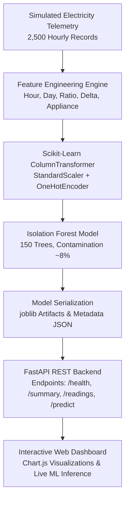

# WattWise — ML-Based Electricity Consumption Anomaly Detection System

[](https://www.python.org/)
[](https://fastapi.tiangolo.com/)
[](https://scikit-learn.org/)
[](https://www.chartjs.org/)
[](https://www.docker.com/)

WattWise is an end-to-end machine learning web application that analyzes electricity consumption readings in real time and flags anomalous power spikes and potential energy waste using an unsupervised **Isolation Forest** ensemble algorithm.

> **Disclaimer:** The dataset in this demonstration contains simulated electricity telemetry engineered with realistic appliance load profiles and deliberately injected anomalous events for model evaluation. The model detects statistical irregularities in multi-dimensional feature space, not confirmed physical hardware defects.

---

## 1. System Architecture



### Key Components:
- **Data Generator (`generate_data.py`)**: Generates 2,500 reproducible hourly records spanning 6 appliance categories with diurnal baseline curves and 8.0% injected anomaly scenarios.
- **Model Training Pipeline (`train.py`)**: Computes derived ratios and deltas, fits a `ColumnTransformer` with `IsolationForest`, evaluates against ground-truth labels, and serializes `models/wattwise_model.joblib`.
- **Inference Engine (`predict.py`)**: Reusable inference pipeline providing calibrated anomaly scores (0% to 100%), risk categories (Low, Elevated, High), and human-interpretable diagnostic explanations.
- **FastAPI Backend (`app.py`)**: Production REST API serving both the telemetry endpoints and the static HTML5/CSS3/ES6 dashboard in a single process.
- **Frontend Dashboard (`static/`)**: Modern dark-navy energy analytics UI with Chart.js time-series plots, appliance breakdown charts, filterable telemetry tables, and 1-click viva demonstration presets.

---

## 2. Key Features

- **Unsupervised Anomaly Detection**: Requires no manual anomaly labeling in production; learns normal multi-dimensional operating clusters directly from data.
- **Domain-Specific Feature Engineering**: Uses temporal cyclic features (`hour`, `day_of_week`), absolute wattage (`power_consumption`, `baseline_consumption`), and derived metrics (`consumption_ratio`, `consumption_diff`).
- **Calibrated Anomaly Scoring**: Decision function values are calibrated to an intuitive 0.0% – 100.0% scale with automated risk level assignment.
- **Contextual Diagnostic Rationale**: Every prediction is accompanied by a plain-language explanation citing appliance type, time of day, and degree of deviation from nominal baseline.
- **Professor Demo Presets**: Instant 1-click scenario triggers for normal daytime HVAC, off-peak compressor runaway, refrigerator door seal leaks, and stuck water heater elements.
- **Zero-Dependency Frontend**: Pure HTML5, Vanilla CSS, and modern ES6 JavaScript with Chart.js — no Node.js, React, or heavy build steps required.

---

## 3. Machine Learning Algorithm: Isolation Forest

### Theoretical Intuition
Traditional anomaly detection methods attempt to define the dense boundary of "normal" instances (e.g., One-Class SVM, Mahalanobis distance) and declare points outside that boundary as outliers. This becomes computationally expensive and susceptible to the curse of dimensionality.

**Isolation Forest (Liu et al., 2008)** operates on the opposite principle: **it isolates anomalies instead of profiling normal points**.

Because anomalies are "few and different":
1. They exist in sparse regions of the feature space.
2. They have attribute values noticeably distinct from nominal clusters.

When an ensemble of randomized binary partition trees (Isolation Trees / iTrees) is grown by recursively choosing a random feature and a random split value between its minimum and maximum:
- **Anomalous points are isolated near the root** (requiring very few splits).
- **Normal points cluster densely** and require significantly deeper splits to isolate.

### Mathematical Formulation
For an instance $x$ and a dataset of size $n$, the path length $h(x)$ is the number of edges traversed from the root of an iTree to a terminating leaf node.

The average path length of unsuccessful searches in a Binary Search Tree (BST) provides the theoretical normalizing factor:
$$c(n) = 2 \ln(n - 1) + 0.5772156649 \text{ (Euler-Mascheroni constant)} - \frac{2(n - 1)}{n}$$

The anomaly score $s(x, n)$ over an ensemble of $T$ trees is defined as:
$$s(x, n) = 2^{-\frac{\mathbb{E}(h(x))}{c(n)}}$$

- If $\mathbb{E}(h(x)) \to 0 \implies s(x, n) \to 1$: Highly anomalous (isolated in very few splits).
- If $\mathbb{E}(h(x)) \to c(n) \implies s(x, n) \to 0.5$: Indifferent / borderline.
- If $\mathbb{E}(h(x)) \to n - 1 \implies s(x, n) \to 0$: Distinctly normal cluster.

### Model Evaluation Results (on 2,500 Simulated Readings)

| Metric | Score | Interpretation |
|---|---|---|
| **Precision** | **0.9900** | 99% of flagged anomalies are genuine simulated events |
| **Recall** | **0.9900** | 99% of all simulated anomalies were successfully captured |
| **F1-Score** | **0.9900** | Optimal harmonic balance between false alarms and missed events |
| **ROC-AUC** | **0.9999** | Exceptional separation between normal clusters and outliers |
| **True Negatives** | 2,298 | Routine operating records correctly classified as normal |
| **False Positives** | 2 | Normal operating fluctuations flagged as anomalies |
| **False Negatives** | 2 | Subtle anomalous fluctuations missed |
| **True Positives** | 198 | Anomalous power events correctly identified |

---

## 4. Dataset Generation & Appliance Profiles

The dataset simulates a typical electrified household with 6 high-impact appliance categories:

| Appliance | Daytime Nominal (W) | Nighttime Nominal (W) | Typical Anomaly Injected |
|---|---|---|---|
| **HVAC / Heat Pump** | 1,800 W | 450 W | Continuous full-load runaway at 3 AM (3,800 W) |
| **Refrigeration** | 160 W | 110 W | Gasket seal failure / door ajar overnight (650 W) |
| **Water Heater** | 2,800 W | 80 W | Heating element stuck active at 2 AM (4,200 W) |
| **Lighting** | 60 W | 20 W | High-power floodlights left on at midday (1,450 W) |
| **EV Charger** | 40 W | 3,600 W | Unscheduled peak-tariff charging spike (7,200 W) |
| **Laundry / Kitchen** | 1,200 W | 15 W | Electric oven / range element left on unattended (2,600 W) |

Total records: **2,500 hourly readings**  
Target Contamination: **8.0% (200 anomalies)**

---

## 5. Installation & Local Execution

### Prerequisites
- Python 3.10+ (Python 3.12 recommended)
- `pip`

### Step-by-Step Setup

1. **Clone or navigate to the repository:**
   ```bash
   cd c:\Users\Lenovo\Desktop\WattWise
   ```

2. **Install dependencies:**
   ```bash
   pip install -r requirements.txt
   ```

3. **Generate the synthetic dataset (if needed):**
   ```bash
   python generate_data.py
   ```

4. **Train the Isolation Forest model:**
   ```bash
   python train.py
   ```

5. **Run the automated test suite:**
   ```bash
   python test_app.py
   ```

6. **Start the FastAPI application:**
   ```bash
   uvicorn app:app --host 0.0.0.0 --port 10000
   ```

7. **Access the application:**
   - **Interactive Web Dashboard:** `http://localhost:10000`
   - **Interactive Swagger Documentation:** `http://localhost:10000/docs`
   - **Alternative ReDoc Documentation:** `http://localhost:10000/redoc`

---

## 6. Docker Containerization

The project includes a self-contained multi-stage-ready `Dockerfile` that packages the application, generates data and model artifacts, and launches the server.

### Build the Docker Image
```bash
docker build -t wattwise .
```

### Run the Docker Container
```bash
docker run --rm -p 10000:10000 -e PORT=10000 wattwise
```

Open `http://localhost:10000` in any web browser.

---

## 7. REST API Reference

### 1. Health Status
- **Method:** `GET /health`
- **Response:**
  ```json
  {
    "status": "healthy",
    "model_loaded": true,
    "readings_count": 2500,
    "version": "1.0.0"
  }
  ```

### 2. Dataset & Analytics Summary
- **Method:** `GET /api/summary`
- **Response:**
  ```json
  {
    "total_readings": 2500,
    "anomaly_count": 200,
    "normal_count": 2300,
    "anomaly_percentage": 8.0,
    "average_consumption_watts": 1265.4,
    "average_baseline_watts": 1041.2,
    "by_appliance": [ ... ],
    "hourly_anomalies": [ ... ]
  }
  ```

### 3. Query Telemetry Readings
- **Method:** `GET /api/readings?limit=25&offset=0&anomaly_only=true`
- **Parameters:**
  - `limit` (int, default: 100): Records per page
  - `offset` (int, default: 0): Pagination offset
  - `anomaly_only` (bool, default: false): Filter only flagged anomalies
  - `appliance` (str, optional): Filter by appliance name

### 4. Live Anomaly Inference
- **Method:** `POST /api/predict`
- **Headers:** `Content-Type: application/json`
- **Sample Request (Anomalous HVAC Spike):**
  ```bash
  curl -X POST "http://localhost:10000/api/predict" \
    -H "Content-Type: application/json" \
    -d '{
      "hour": 3,
      "day_of_week": 1,
      "appliance": "HVAC",
      "power_consumption": 3850.0,
      "baseline_consumption": 450.0
    }'
  ```
- **Sample Response:**
  ```json
  {
    "status": "Anomalous",
    "is_anomaly": true,
    "anomaly_score": 0.6318,
    "anomaly_score_percentage": 63.2,
    "risk_level": "Elevated",
    "features": {
      "hour": 3,
      "day_of_week": 1,
      "appliance": "HVAC",
      "power_consumption_watts": 3850.0,
      "baseline_consumption_watts": 450.0,
      "consumption_ratio": 8.56,
      "consumption_diff_watts": 3400.0
    },
    "explanation": "Excessive consumption spike detected! Current load of 3,850.0W is 855% of the standard baseline (450.0W) for HVAC at hour 03:00 (early morning). Potential cause: continuous heating element stuck on, unsealed thermal envelope, or compressor fault.",
    "disclaimer": "WattWise detects statistical irregularities via unsupervised Isolation Forest. Flagged readings indicate mathematical deviation from baseline profiles, not confirmed physical defects."
  }
  ```

---

## 8. Limitations & Real-World Considerations

1. **Statistical vs. Physical Anomaly**: The model detects multidimensional deviations from nominal clusters. A legitimate party or late-night cooking session may be flagged as an anomaly despite no equipment malfunction.
2. **Seasonal Drift**: Heating and cooling baselines shift substantially between summer and winter. In production, rolling or seasonal retraining (concept drift adaptation) is essential.
3. **Sub-Metering vs. Whole-House NILM**: The current model evaluates discrete appliance feeds. For whole-home single-meter feeds, Non-Intrusive Load Monitoring (NILM) techniques would be required first to disaggregate individual loads.

---

## 9. Viva / Oral Examination Quick Reference Sheet

### Q1: Why did you choose Isolation Forest instead of a supervised classifier like Random Forest or XGBoost?
> **Answer:** In electricity consumption telemetry, genuine faults and energy waste events are rare, unpredictable, and rarely labeled in advance. Supervised learning requires balanced, labeled datasets that do not reflect real-world smart meter deployments. Isolation Forest is unsupervised; it requires no historical anomaly labels and detects unexpected behavioral shifts by isolating points that diverge from normal clusters.

### Q2: How does Isolation Forest mathematically isolate an anomalous point?
> **Answer:** It builds an ensemble of random binary partition trees (iTrees). At each node, a feature is selected at random, and a split point is chosen between the feature's minimum and maximum. Outliers exist in sparse regions far from dense clusters, so they are isolated after very few random cuts (short path length). Normal points reside in dense clusters and require many cuts to isolate (long path length). The anomaly score is an exponential function of average tree depth relative to the expected depth in a random binary search tree.

### Q3: What is the significance of the contamination parameter?
> **Answer:** Contamination specifies the expected proportion of outliers in the training dataset (we configured 0.08, or 8%). It determines the decision threshold offset on the raw decision function. Readings scoring below this offset receive a label of `-1` (anomalous), while those above receive `+1` (normal).

### Q4: Why did you engineer the `consumption_ratio` and `consumption_diff` features?
> **Answer:** While raw wattage differs radically across appliances (an EV draws 7 kW while a lightbulb draws 20 W), the ratio of observed consumption to baseline provides scale-invariant normalization. A 3x ratio for a refrigerator (150 W → 450 W) is just as anomalous as a 3x surge on an HVAC unit, allowing the Isolation Forest to split effectively across diverse appliance scales.

### Q5: How would this system scale in a commercial utility environment?
> **Answer:** Isolation Forest has linear time complexity $O(t \cdot \psi \log \psi)$, where $t$ is the number of trees and $\psi$ is subsampling size. Because trees are independent, training and batch inference can be parallelized across multi-core CPUs. In production, incoming Kafka/MQTT telemetry streams would be batched and evaluated against cached models with sub-millisecond latency per reading.

---

## 10. Repository File Structure

```
WattWise/
├── data/
│   └── electricity_readings.csv     # 2,500 simulated hourly electricity readings
├── models/
│   ├── wattwise_model.joblib        # Serialized preprocessor + Isolation Forest pipeline
│   └── model_metadata.json         # Evaluation metrics, calibration params, feature list
├── static/
│   ├── index.html                   # Responsive analytics dashboard markup
│   ├── style.css                    # Dark navy & emerald energy design system
│   └── script.js                    # Chart.js integration, live inference, table filtering
├── app.py                           # FastAPI REST server & static file host
├── generate_data.py                 # Synthetic reproducible telemetry generator
├── train.py                         # Isolation Forest training & evaluation script
├── predict.py                       # Reusable anomaly inference logic
├── test_app.py                      # Automated ASGI API test suite
├── Dockerfile                       # Container definition for reproducible deployment
├── .dockerignore                    # Excluded files during container build
├── requirements.txt                 # Pinned Python package dependencies
└── README.md                        # Complete project documentation & viva guide
```
